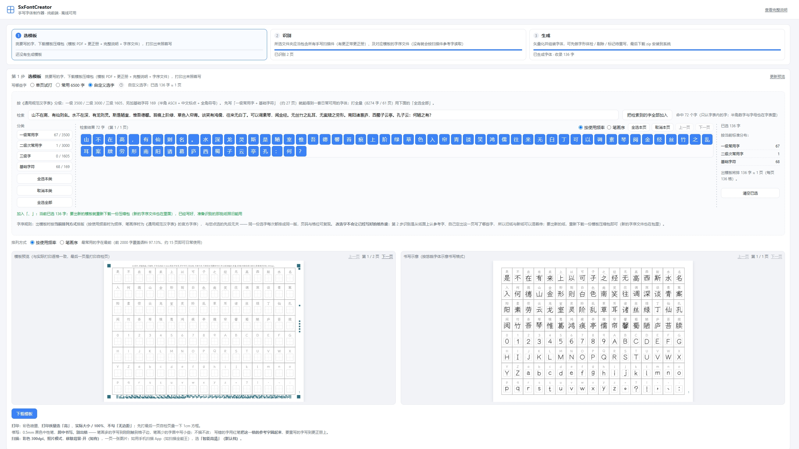
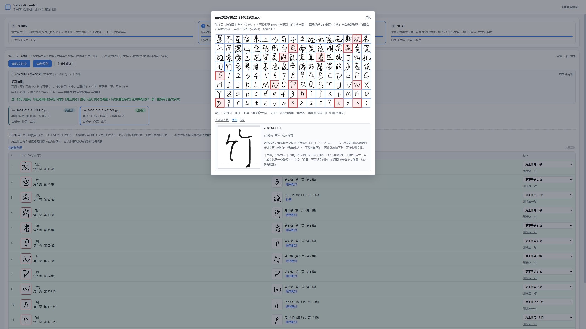
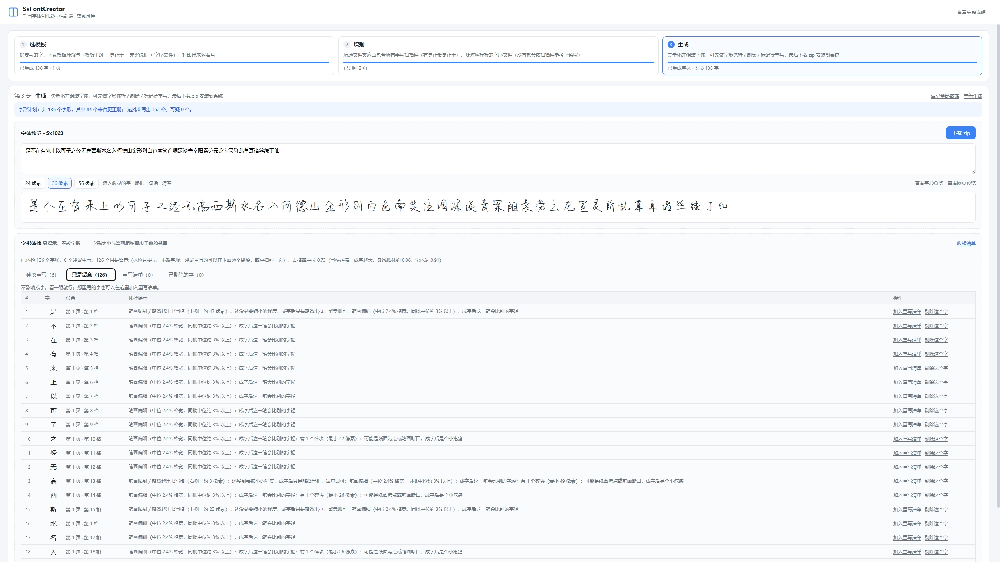

# SxFontCreator — Handwriting Font Creator

[中文](README.md) ｜ English

[](LICENSE)
[](https://vuejs.org/)
[](https://vitejs.dev/)
[](https://github.com/mmingji/SxFontCreator)
[](package.json)

> Repository: https://github.com/mmingji/SxFontCreator ｜ Licence: GPL-2.0 (see [LICENSE](LICENSE))

Print a template → write the characters by hand in the grid → scan the pages back → the app slices every cell, extracts the strokes and builds a personal handwriting font (TTF / woff / woff2).

Pure front-end, no backend, fully offline (double-click `dist/index.html`, no local server). **All data stays in your browser** — clearing browser data, switching computers or browsers loses it; just re-point the scan folder and run recognition again (recognition is deterministic). **Original scans are never stored by the app — keep your own copy.**

This README is an **entry index** only: how to run, where things are. The user-facing guide is `public/使用说明.html` (single source: `src/lib/guide.js` → `npm run guide`).

> The documentation is written in Chinese; this English README is a faithful summary for international readers.

## Screenshots

| Step 1 — Template | Step 2 — Recognise & inspect cells | Step 3 — Generate & preview |
| --- | --- | --- |
|  |  |  |

## Getting started

```
npm install          # if npm hits an EPERM cache error: npm install --cache .npm-cache
npm run dev          # dev server: http://localhost:5173 (do not set TEMP to the project when running dev)
npm run build        # build to dist/; double-click dist/index.html — file:// works, no server needed
npm run pack         # build and zip a distributable: release/SxFontCreator-<version>-便携版.zip
npm test             # full suite: unit → build → dist zip → file:// probe → end-to-end smoke
npm run guide        # regenerate the single-file user guide (public/使用说明.html)
```

Before building or testing, set `TEMP` to `test/.tmp/esbuild`; **do not** do that while running `dev`.

## Layout

| Directory | Contents |
| --- | --- |
| `src/lib/` | Image processing, font building, layout, recognition and local storage modules |
| `src/workers/` | Web Worker for the recognition pipeline (preprocess / slice / reference-char matching / stroke extraction) |
| `src/components/` | UI components: the three-step wizard (template / recognise / generate) and its panels |
| `src/store/` | Project state (Pinia); `projectData()` is the single list of persisted fields |
| `src/data/` | Generated data (character set, frequency order) — **do not edit by hand** |
| `public/` | Built-in font subsets and licences, the single-file user guide, the woff2 wasm |
| `scripts/` | Build-time scripts (charset / frequency / font subset / packaging) and read-only inspectors |
| `screenshots/` | The three UI screenshots used in this README |

## Third-party components

See [THIRD-PARTY-NOTICES.md](THIRD-PARTY-NOTICES.md). Built-in fonts: LXGW WenKai (reference characters on the template, OFL-1.1, full licence in `public/fonts/OFL.txt`) and Yozai (sample glyphs for the writing guide, OFL-1.1, full licence in `public/fonts/OFL-yozai.txt`).

## Licence

The source code is released under the **GNU General Public License v2.0** (see [LICENSE](LICENSE); the same full text ships with the app as `public/LICENSE-GPL-2.0.txt`, included in `dist/` and the portable zip).

- Third-party components and data are listed in [THIRD-PARTY-NOTICES.md](THIRD-PARTY-NOTICES.md). `esm-potrace-wasm` (potrace packaged as WASM) is **GPL-2.0**; publishing this repository satisfies its source-code requirement. When distributing build artifacts, ship the GPL text and the source URL.
- **Fonts generated by this app are not covered by the GPL** — they are the product of your own handwriting and can be used and shared freely.
- `src/data/charRank.js` uses Jun Da's *Modern Chinese Character Frequency List*, which is **for research and teaching purposes only, non-commercial**; commercial use requires the author's written permission (see THIRD-PARTY-NOTICES.md for alternatives).
- Running the app on your own machine, or sharing the generated fonts, does not trigger any GPL distribution obligation.
